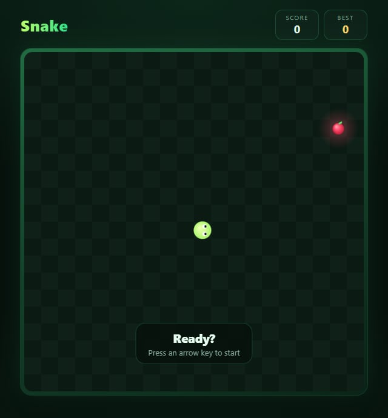

# Snake

The classic snake game in plain JavaScript and the Canvas 2D API. No libraries and no build step.

**[Play it live →](https://taha-shajarian.ir/projects/simple-snake)**



## Features

- A 20 × 20 board that speeds up as the snake grows (125 ms per step down to 75 ms)
- Keyboard (arrow keys or WASD) and swipe controls, so it plays on phones
- Best score saved locally, with a game-over card and instant restart
- Responsive layout that fits the board to the screen

## Controls

| Action | Keyboard | Touch |
| --- | --- | --- |
| Steer / start | arrow keys or <kbd>W</kbd> <kbd>A</kbd> <kbd>S</kbd> <kbd>D</kbd> | swipe |
| Play again | <kbd>Enter</kbd> or <kbd>Space</kbd> | tap **Play again** |

## Run locally

Open `index.html` in a browser, or serve the folder:

```sh
npx serve .
```
